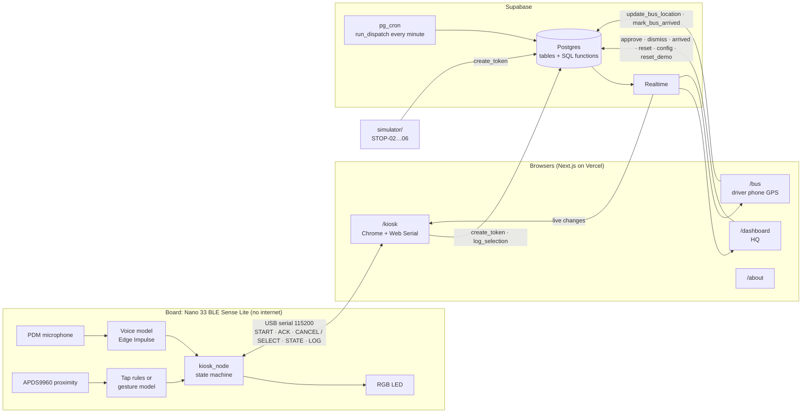
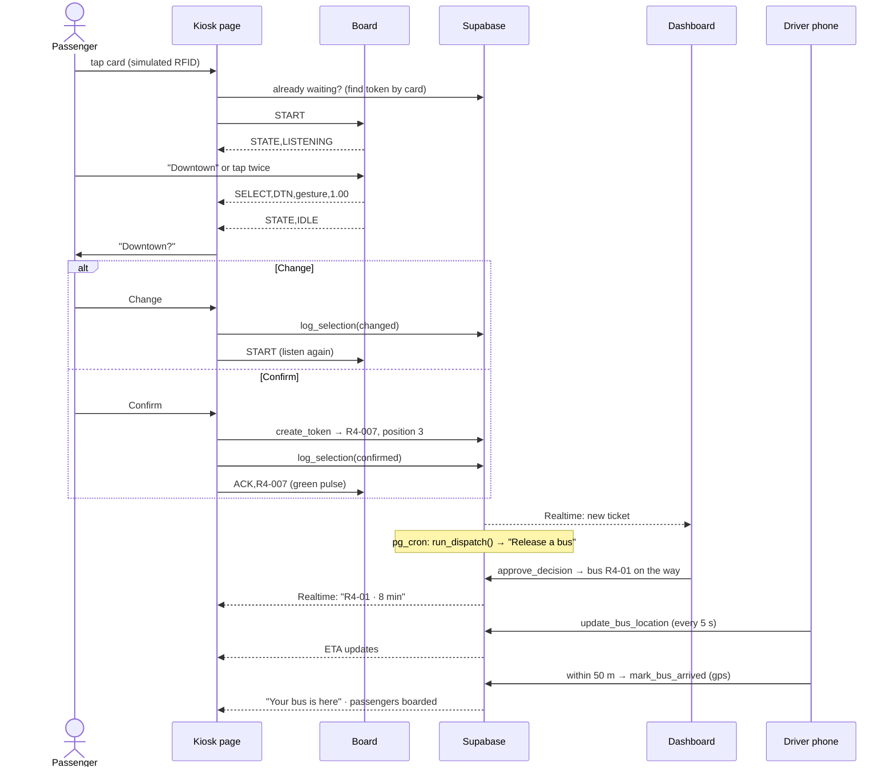
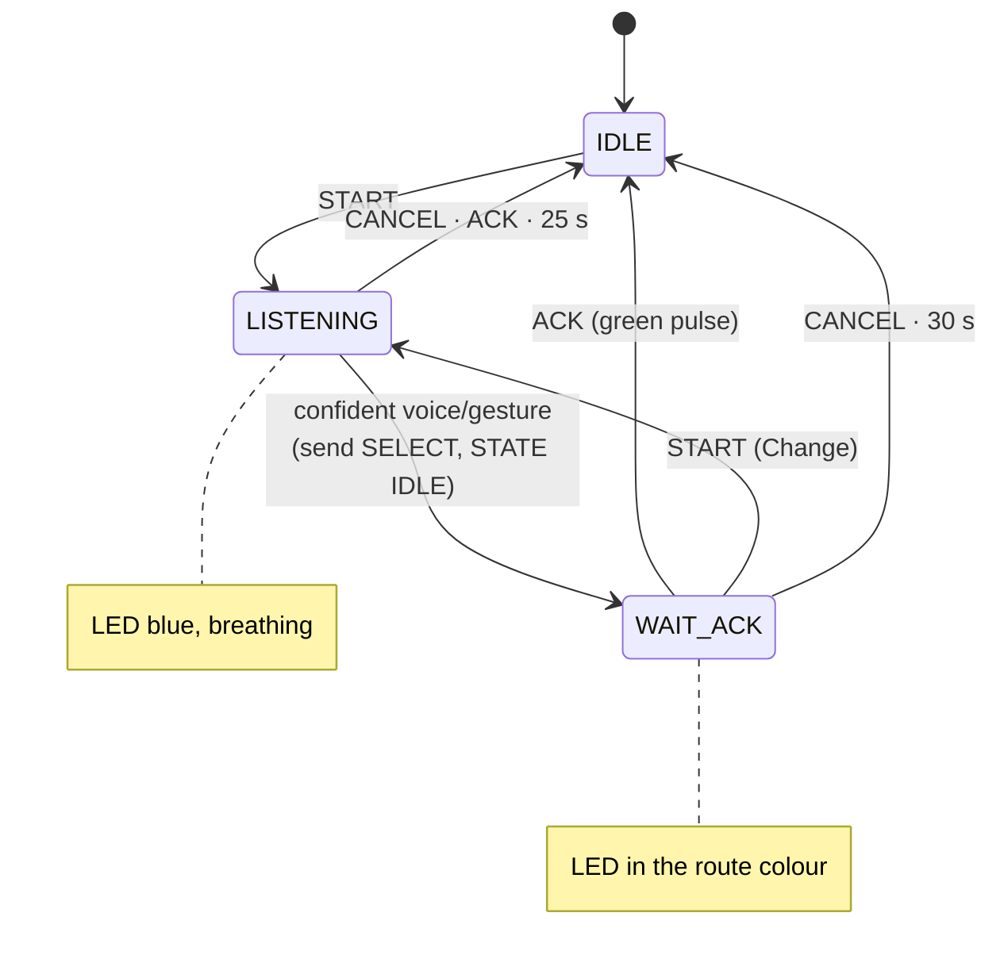
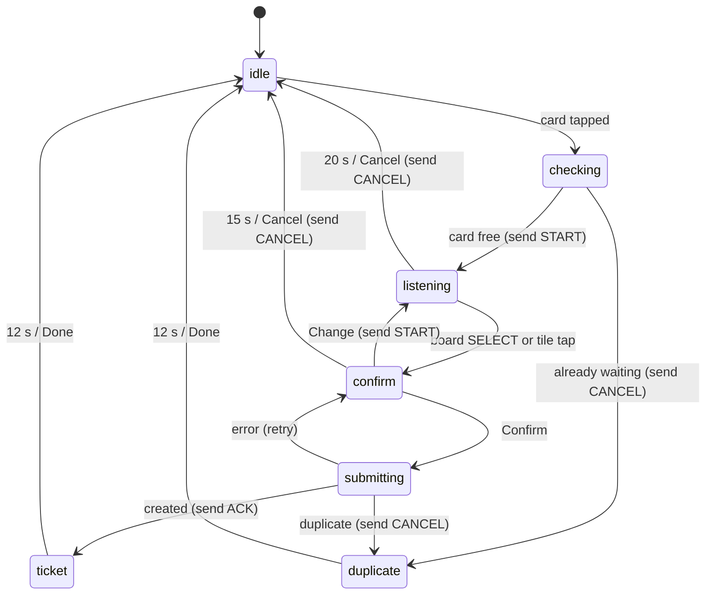

# Tap&Select architecture

## What runs where

- The board never talks to the internet; the kiosk page is its gateway.
- Every business rule (queue numbers, dispatch, ETA, boarding) is a Postgres function, so all
  screens behave the same and the simulator uses the same path as the kiosk.
- Screens never poll: they reload their data when Realtime reports a change.

## A passenger's journey

## Board state machine

## Kiosk steps

Source: `apps/web/lib/kiosk-machine.ts` (`kioskReducer` + `transitionEffects`, both unit-tested).
